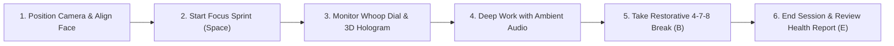

# FocusLens User & Architecture Guide

> A step-by-step introduction and complete terminology guide to the private, on-device AI cognitive focus and ergonomic telemetry companion.

---

## 1. Introduction: What is FocusLens?

**FocusLens** is an intelligent, privacy-first telemetry cockpit designed for software engineers, researchers, and knowledge workers. It operates continuously in the browser using on-device computer vision models running via **WebAssembly (WASM)** and **WebGL acceleration**.

Unlike traditional timer apps or surveillance software:
- **No Video Leaves Your Device**: Your webcam feed is processed directly inside client volatile memory and immediately discarded. No video, audio, or biometric data is ever uploaded to any cloud server.
- **Biometric Health Defense**: FocusLens actively monitors eye blink rates to prevent digital eye strain (*asthenopia*), tracks 3D cervical spine orientation to stop slouching, and detects involuntary fatigue and microsleeps.
- **Calm, High-Signal Cockpit**: Inspired by Linear, Whoop, and Vercel design principles, dense telemetry is presented with visual restraint, 1px hairline borders, and clear color-coded states.

---

## 2. Meet LensBot: Your In-App AI Guide

When you launch FocusLens, **LensBot** (your on-device AI guide bot) is available in the bottom-left corner of the application. 

LensBot greets you and provides:
1. **Interactive 10-Step Guided Tour**: Takes you through each section of the application with highlighted visual cards.
2. **Instant Terminology Explainer**: Clickable cards explaining complex biometric and acoustic terms in simple, plain English.
3. **Architecture & Privacy Details**: A transparent breakdown of client-side WASM execution and local IndexedDB storage.
4. **Quick FAQ Chips**: One-click answers to questions like *"What is EAR?"*, *"Why are 40Hz binaural beats useful?"*, and *"How does posture tracking work?"*.

---

## 3. Step-by-Step Walkthrough

### Step 1: Camera Stage & Clear Alignment Guidelines
- **Where to look**: The top-left panel of the **Live Studio** workspace.
- **What it is**: Your live webcam stream with an intelligent posture alignment overlay.
- **How it guides you**:
  - **Horizontal Eye-Horizon Line**: A glowing guide line indicating where your eyes should rest.
  - **Vertical Plumb Axis**: A vertical guideline passing through your nose bridge to verify head centering.
  - **Target Posture Oval**: When your face is aligned inside the bounding oval, the guides glow **emerald green** (*Aligned*). If you tilt or turn away, they turn **amber** (*Unaligned*).

### Step 2: 3D Cervical Spine Hologram
- **Where to look**: Placed directly beneath the camera feed.
- **What it is**: A real-time Three.js WebGL 3D cybernetic wireframe head model.
- **How it guides you**:
  - Mirrors your head orientation in 3 dimensions:
    - **Yaw**: Horizontal head turning (left or right).
    - **Pitch**: Vertical chin tilt (nodding up or down).
    - **Roll**: Lateral ear-to-shoulder tilting.
  - Monitors forward head posture (FHP) to prevent chronic strain on the C1–C7 cervical vertebrae.
  - **Recenter Baseline**: Press the **R** key anytime to recalibrate your neutral posture.

### Step 3: Whoop Focus Score Dial
- **Where to look**: The top-right dominant circular gauge.
- **What it is**: A single, prominent 0–100 score reflecting your cognitive flow in real time.
- **How it guides you**:
  - **Score &gt; 80 (Emerald Glow)**: Deep Cognitive Flow. Gaze centered, head aligned, steady fixation.
  - **Score 50–79 (Amber)**: Attention Drifting. Head turned away or off-screen gaze detected.
  - **Score &lt; 50 (Rose)**: Fatigue Alert. Prolonged eye closure, yawning, or severe distraction.
  - **Flow Streak**: Displays how long you have maintained uninterrupted focus without drifting.

### Step 4: Sprint Controller & Pomodoro Cycles
- **Where to look**: Right beneath the Whoop Focus Dial.
- **What it is**: Your focus session controller with duration presets: **15m**, **25m**, **45m**, and **60m**.
- **How it guides you**:
  - Displays remaining countdown timer and sprint cycle counter (`Sprint Cycle #1`).
  - **Pause / Resume**: Press **Space** to pause the camera if you step away.
  - **Take Break**: Press **B** to take an instant recovery break.
  - **End Session**: Press **E** to stop telemetry, generate your post-session health report, and save your data.

### Step 5: Guided 4-7-8 Breathing Breaks
- **Where to look**: Triggered by pressing **B** or automatically when a sprint completes.
- **What it is**: A guided restorative break dialog.
- **How it guides you**:
  - **4-7-8 Breathing Orb**: An animated breathing circle that gently pulses through:
    1. *Inhale* for 4 seconds quietly through the nose.
    2. *Hold* calmly for 7 seconds.
    3. *Exhale* smoothly for 8 seconds through the mouth.
  - **20-20-20 Rule**: Reminds you to focus on an object at least 20 feet away for 20 seconds to relax your eye ciliary focusing muscles.

### Step 6: Precision Biometrics Suite
- **Where to look**: The **Biometrics &amp; Affect** tab on the sidebar.
- **What it contains**:
  1. **Eye Dynamics (EAR)**: Eye openness and Blinks Per Minute (BPM) with dry-eye warnings.
  2. **Facial Sentiment &amp; Emotional Valence**: -100% (tension/furrow) to +100% (delight/ease) estimating cognitive strain.
  3. **Screen Gaze Vector Matrix**: A 3x3 quadrant grid mapping your line of sight.
  4. **Fatigue Radar**: Automatic counting of involuntary yawns and microsleep episodes.
  5. **3D Posture Gauges**: Precision degree meters with shaded green ergonomic safe zones (&plusmn;14&deg; Yaw, &plusmn;12&deg; Pitch, &plusmn;10&deg; Roll).

### Step 7: Procedural Ambient Audio Synthesizer
- **Where to look**: The **Ambient Audio** tab on the sidebar.
- **What it is**: Continuous focus soundscapes generated mathematically using the native **Web Audio API**. Zero audio files downloaded.
- **Available Soundscapes**:
  1. **40Hz Gamma Binaural**: Stereo-panned 216Hz L / 256Hz R tones inducing 40Hz cortical synchronization for peak memory and logic flow.
  2. **Deep Brown Noise**: Warm 350Hz low-pass Brownian rumble resembling heavy waterfalls or an airplane cabin.
  3. **Calm Forest Rain**: Filtered pink noise with bandpass filtering that lowers sympathetic nervous tension.
  4. **Ocean Tide &amp; Surf**: 12-second rhythmic swell filter simulating incoming ocean tides to synchronize breathing.
  5. **432Hz Cosmic Drone**: Harmonic chord (432Hz fundamental + 648Hz 5th + 864Hz octave) for stress release.
  6. **Focused White Noise**: Flat spectral energy masking erratic conversational speech.
- **Behavioral Audio Cues**: Audition buttons to preview sprint start arpeggios, neutral posture pings, drift warnings, and fatigue double pulses.

### Step 8: Telemetry Analytics &amp; Session Archive
- **Telemetry Analytics Tab**: Interactive high-DPI canvas timeline chart with hover scrubbing, flow state breakdown (time focused, distracted, drowsy), and one-click **Export CSV** and **Export JSON** buttons.
- **Session Archive Tab**: Secure historical records saved in your browser's IndexedDB with letter grades (**Grade S**, **Grade A**, **Grade B**), durations, and flow percentages.

---

## 4. Biometric Terminology Dictionary

| Term | Category | Plain-English Definition | Healthy / Target Range |
| :--- | :--- | :--- | :--- |
| **Focus Score** | Telemetry Index | Synthetic 0–100 score combining eye fixation, head alignment, and affect. | **&gt; 80** (Optimal Flow) |
| **Eye Aspect Ratio (EAR)** | Computer Vision | Ratio of vertical eyelid opening to horizontal eye length. Drops during blinks. | **0.24 – 0.35** (Open &amp; Relaxed) |
| **Blink Rate (BPM)** | Eye Health | Number of blinks per minute. Drops by 66% during intense screen staring. | **12 – 22 BPM** |
| **Emotional Valence** | Cognitive Affect | Facial blendshape balance between smile contractions and brow furrow strain. | **&gt; 0%** (Calm / Ease) |
| **3D Head Yaw** | Ergonomics | Horizontal head rotation (turning left or right). | **&plusmn;14&deg;** |
| **3D Head Pitch** | Ergonomics | Vertical head tilt (chin nodding up or looking down). | **&plusmn;12&deg;** |
| **3D Head Roll** | Ergonomics | Lateral ear-to-shoulder tilting. | **&plusmn;10&deg;** |
| **Gaze Vector** | Attention | Pupil/iris center offset relative to the eye bounding box. | **Center Quadrant** |
| **Microsleep** | Fatigue | Involuntary eye closure with EAR &lt; 0.16 lasting longer than 1.8 seconds. | **0 events** |
| **Yawn (MAR)** | Fatigue | Mouth Aspect Ratio &gt; 0.65 sustained for over 2.5 seconds. | **0 – 1 events** |
| **40Hz Gamma Beats** | Neuroacoustics | Frequency delta between stereo channels linked to cognitive working memory. | **40Hz beat frequency** |
| **On-Device WASM** | Architecture | Executing AI models locally in client WebAssembly with zero network transfer. | **100% Client-Side** |

---

## 5. Keyboard Shortcuts Suite

| Key | Action | Description |
| :---: | :--- | :--- |
| **Space** | Start / Pause | Commences camera tracking or pauses session |
| **R** | Recenter Baseline | Calibrates current head orientation as neutral 0&deg; posture |
| **B** | Take Break | Opens 4-7-8 guided box breathing recovery break |
| **E** | End Session | Concludes session and opens full health report |
| **M** | Toggle Audio Alerts | Mutes or unmutes behavioral psychoacoustic chimes |
| **H** | Toggle AI HUD | Shows or hides the 478-point facial mesh on camera feed |
| **T** | Toggle Theme | Switches between Dark cockpit and Light mode |
| **?** | Shortcuts Dialog | Opens complete keyboard shortcut reference dialog |
| **Cmd+K** / **Ctrl+K** | Command Palette | Launches Raycast-style instant action launcher |

---

## 6. Privacy &amp; Verification

To independently verify that FocusLens never uploads your camera feed:
1. Open your browser's **Developer Tools** (Press `F12` or `Cmd+Option+I`).
2. Switch to the **Network** tab and select **WS** (WebSockets) or **Fetch/XHR**.
3. Start a focus session.
4. **Result**: Zero video, audio, or biometric packets are transmitted across the network. All inference is strictly executed inside your device's WebAssembly sandbox.
